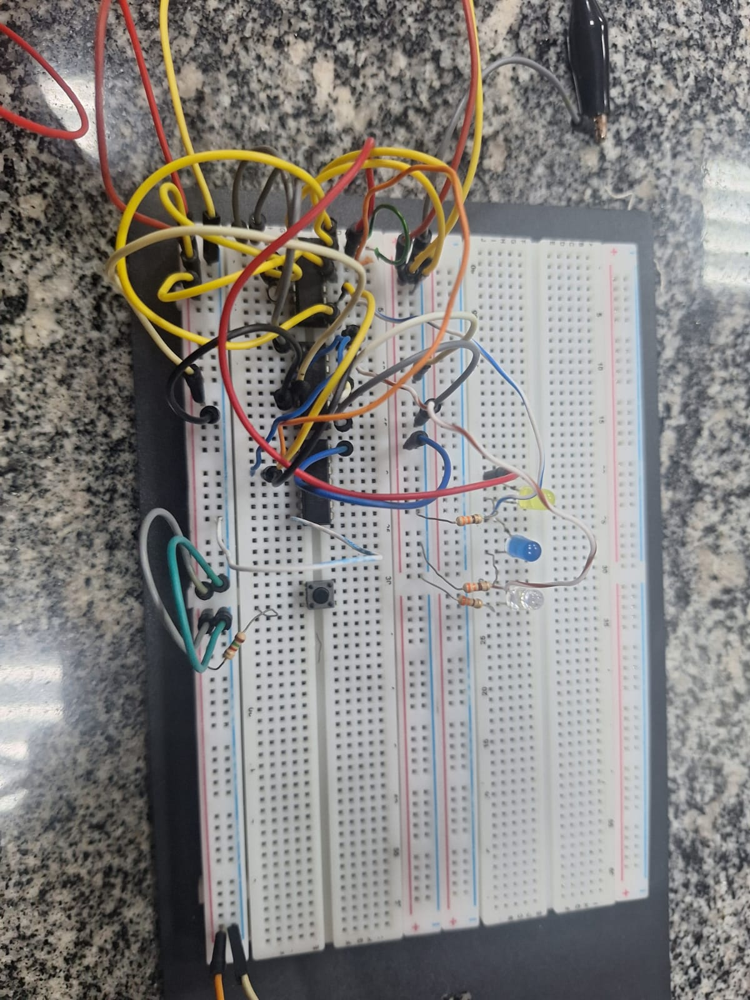
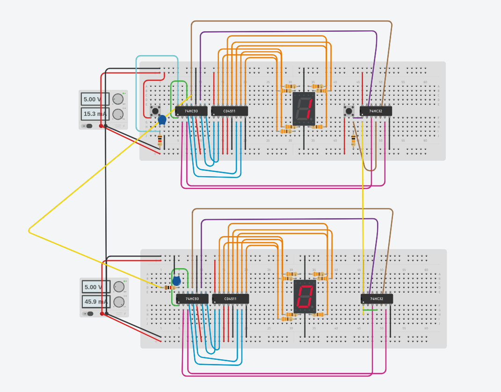
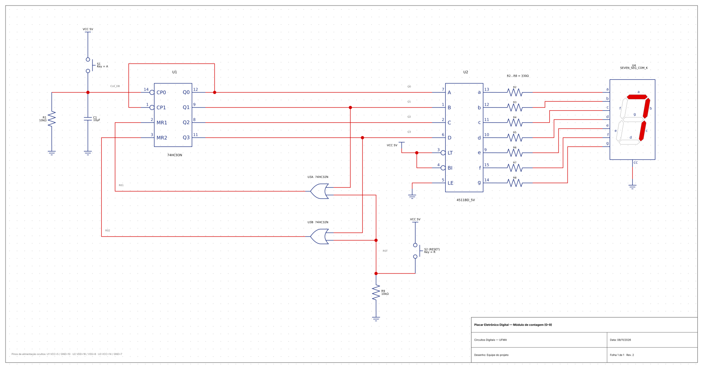
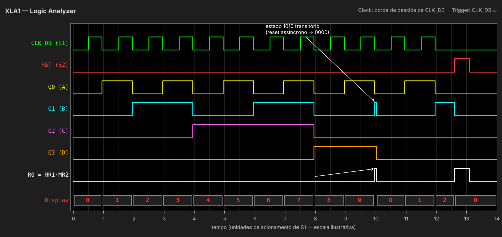
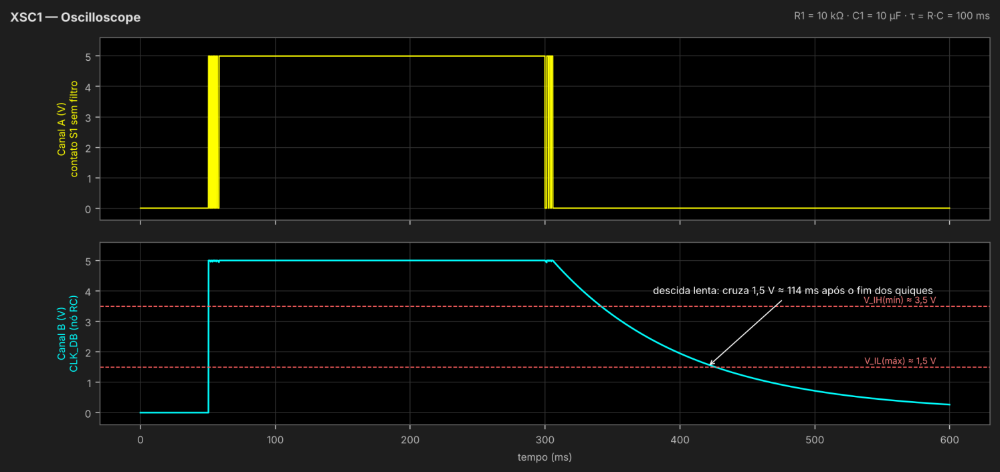
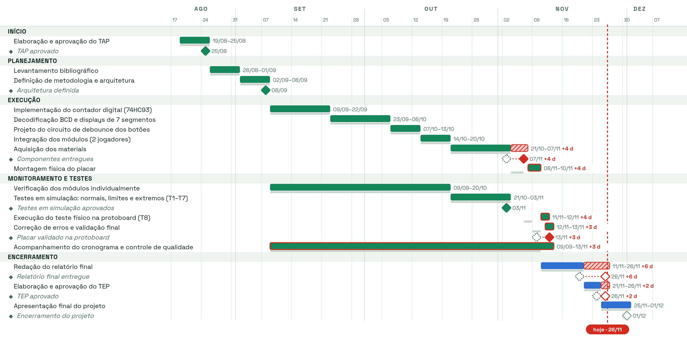

# Placar Eletrônico Digital

> Placar de pontos para dois jogadores feito **só com lógica digital**: sem microcontrolador e sem nenhuma linha de código no circuito.

Projeto da disciplina de **Circuitos Digitais** do curso de Engenharia da Computação da **Universidade Federal do Maranhão (UFMA)**, 2026.



| | |
|---|---|
| **Orientador** | Prof. Luiz Henrique Neves Rodrigues |
| **Equipe** | André Luís Aguiar · Guilherme Passinho · Hugo Oliveira · Raí Abreu |
| **Período** | 19/08/2026 a 01/12/2026 (105 dias) |
| **Situação** | Execução concluída. O placar funciona na simulação e na protoboard; o projeto está na fase de Encerramento. |
| **Custo dos materiais** | R$ 82,25 sem frete (R$ 20,56 por integrante) |
| **Ferramentas** | Tinkercad Circuits (protoboard virtual) e esquemático no padrão NI Multisim |

---

## Sumário

1. [O que o placar faz](#1-o-que-o-placar-faz)
2. [Arquitetura](#2-arquitetura)
3. [Bloco 1: entrada e debounce](#3-bloco-1-entrada-e-debounce)
4. [Bloco 2: contador de década (74HC93)](#4-bloco-2-contador-de-década-74hc93)
5. [Bloco 3: decodificação BCD → 7 segmentos (CD4511)](#5-bloco-3-decodificação-bcd--7-segmentos-cd4511)
6. [Placar de dois jogadores](#6-placar-de-dois-jogadores)
7. [Pinagem de referência dos CIs](#7-pinagem-de-referência-dos-cis)
8. [Simulação](#8-simulação)
9. [Testes](#9-testes)
10. [Lista de materiais e custos](#10-lista-de-materiais-e-custos)
11. [Como montar](#11-como-montar)
12. [Problemas conhecidos e melhorias](#12-problemas-conhecidos-e-melhorias)
13. [Cronograma](#13-cronograma)
14. [Estrutura do repositório](#14-estrutura-do-repositório)
15. [Como regenerar os materiais](#15-como-regenerar-os-materiais)
16. [Referências](#16-referências)

---

## 1. O que o placar faz

O placar segue o mesmo princípio de um placar de quadra, em escala de bancada. São três requisitos:

- **Apertou, contou.** Cada jogador tem um botão que soma 1 ponto, de 0 a 9. Depois do 9, a contagem volta para 0.
- **Aparece no display.** Cada jogador tem seu próprio display de 7 segmentos.
- **Um botão zera tudo.** Um único botão de reset volta os dois placares para 0 ao mesmo tempo.

## 2. Arquitetura

O circuito tem três blocos em cadeia, repetidos para cada jogador:

```
 ┌──────────────────────┐    CLK    ┌──────────────────────┐  Q0..Q3  ┌──────────────────────┐  a..g   ┌─────────┐
 │ 1 · ENTRADA          │ ────────► │ 2 · CONTAGEM         │ ───────► │ 3 · VISUALIZAÇÃO     │ ──────► │ Display │
 │ Botão + filtro RC    │           │ 74HC93 (MOD-10)      │   BCD    │ CD4511 + 7 × 330 Ω   │         │ 7 seg.  │
 │ R = 10 kΩ, C = 10 µF │           │ + 2 portas OR 74HC32 │          │                      │         │ cat. com│
 └──────────────────────┘           └──────────────────────┘          └──────────────────────┘         └─────────┘
                                              ▲
                     RST (botão de reset com pull-down de 10 kΩ, compartilhado pelos dois jogadores)
```

| Bloco | Função | Componentes |
|---|---|---|
| 1 · Entrada | Gera um único pulso de clock por toque, eliminando o repique (*bounce*) do contato | Botão táctil, R = 10 kΩ, C = 10 µF; reset com pull-down de 10 kΩ |
| 2 · Contagem | Conta de 0 a 9 e se zera sozinho ao chegar em 10 | 74HC93 + 2 portas OR do 74HC32 |
| 3 · Visualização | Converte o código BCD de 4 bits nos 7 segmentos | CD4511 + 7 resistores de 330 Ω + display de catodo comum |

A metodologia de projeto seguiu o ciclo **problema → análise → síntese → verificação**: cada bloco foi descrito por tabela-verdade ou sequência de estados, simplificado algebricamente, montado em simulação e verificado sozinho antes da integração.

## 3. Bloco 1: entrada e debounce

**O problema.** Ao fechar e ao abrir, o contato mecânico do botão oscila por cerca de 1 ms. O contador é sensível a borda, então cada oscilação seria contada como um ponto.

**A solução.** O botão S1 liga o nó `CLK_DB` ao VCC. Esse nó vai ao terra por um capacitor C1 em paralelo com o resistor R1:

```
 VCC (5 V)
    │
   [S1]  botão de incremento
    │
    ├──────────────► CLK_DB ──► CP0 do 74HC93
    │       │
   [R1]   [C1]
  10 kΩ   10 µF
    │       │
   GND     GND
```

- Com o botão fechado, C1 carrega na hora até 5 V.
- Durante as aberturas rápidas do bounce, C1 descarrega devagar por R1, com constante de tempo

  **τ = R1 · C1 = 10 kΩ × 10 µF = 100 ms**

  Como o bounce dura ~1 ms, a tensão fica acima de V<sub>IH</sub> e o contador enxerga uma só transição.
- Depois que o botão é solto, a tensão leva **t = τ · ln(5 / 1,5) ≈ 120 ms** para cruzar V<sub>IL</sub> ≈ 1,5 V. É nessa **borda de descida** que o 74HC93 incrementa.

> **Consequência:** o ponto é registrado quando o botão é **solto**, não quando é pressionado. Esse comportamento foi aceito e documentado.

O botão de reset S2 usa um resistor de pull-down R9 = 10 kΩ, que mantém `RST` em 0 enquanto o botão está solto.

## 4. Bloco 2: contador de década (74HC93)

O 74HC93 tem um flip-flop divisor por 2 (entrada `CP0`, saída `Q0`) e um contador divisor por 8 (entrada `CP1`, saídas `Q1` a `Q3`). Ligando `Q0` a `CP1`, ele vira um contador binário assíncrono (*ripple*) de 4 bits, de 0 a 15, que avança na borda de descida do clock. Internamente, todos os flip-flops são zerados de forma assíncrona quando `MR1` e `MR2` estão em nível alto ao mesmo tempo (`R0 = MR1 · MR2`).

Para limitar a contagem a 0–9, o contador precisa ser zerado ao chegar em **10 (1010₂)**, o primeiro estado em que `Q3` e `Q1` valem 1 ao mesmo tempo. Como o reset manual também precisa zerar o contador, cada entrada MR recebe uma porta OR:

```
MR1 = Q1 + RST
MR2 = Q3 + RST

R0  = MR1 · MR2 = (Q1 + RST) · (Q3 + RST) = Q1 · Q3 + RST
```

(pela propriedade distributiva X + Y·Z = (X + Y)·(X + Z)). O contador zera quando chega em 10 **ou** quando o botão de reset é pressionado.

### Sequência de estados (RST = 0)

| Pulso | Q3 | Q2 | Q1 | Q0 | MR1 = Q1+RST | MR2 = Q3+RST | R0 | Display |
|:-:|:-:|:-:|:-:|:-:|:-:|:-:|:-:|:-:|
| 0 | 0 | 0 | 0 | 0 | 0 | 0 | 0 | 0 |
| 1 | 0 | 0 | 0 | 1 | 0 | 0 | 0 | 1 |
| 2 | 0 | 0 | 1 | 0 | 1 | 0 | 0 | 2 |
| 3 | 0 | 0 | 1 | 1 | 1 | 0 | 0 | 3 |
| 4 | 0 | 1 | 0 | 0 | 0 | 0 | 0 | 4 |
| 5 | 0 | 1 | 0 | 1 | 0 | 0 | 0 | 5 |
| 6 | 0 | 1 | 1 | 0 | 1 | 0 | 0 | 6 |
| 7 | 0 | 1 | 1 | 1 | 1 | 0 | 0 | 7 |
| 8 | 1 | 0 | 0 | 0 | 0 | 1 | 0 | 8 |
| 9 | 1 | 0 | 0 | 1 | 0 | 1 | 0 | 9 |
| (10) | 1 | 0 | 1 | 0 | 1 | 1 | **1 → zera** | transitório → 0 |

O estado 1010 só existe durante o tempo de propagação do reset (dezenas de nanossegundos na família HC), por isso **o 10 nunca aparece no display**. O analisador lógico da simulação mostra esse pulso (ver [seção 8](#8-simulação)).

Em nível de portas, o 74HC93 equivale a quatro flip-flops JK com J = K = 1 (modo T), disparados na borda de descida e ligados em cascata, mais uma porta NAND que gera o *clear* ativo em nível baixo quando `MR1 · MR2 = 1`.

## 5. Bloco 3: decodificação BCD → 7 segmentos (CD4511)

O CD4511 recebe o código BCD nas entradas `A` (LSB), `B`, `C` e `D` (MSB), ligadas a `Q0`–`Q3` do contador, e ativa as saídas `a`–`g` em **nível alto**, como pede um display de **catodo comum**. Cada saída passa por um resistor de 330 Ω para limitar a corrente do segmento.

Entradas de controle fixas:

| Pino | Nível | Efeito |
|---|:-:|---|
| `LT̅` (lamp test) | 1 | Teste de lâmpadas desativado |
| `BI̅` (blanking) | 1 | Apagamento desativado |
| `LE` (latch enable) | 0 | Latch transparente: o display segue o contador direto |

### Tabela-verdade (1 = segmento aceso)

```
  ─a─
 f   b
  ─g─
 e   c
  ─d─
```

| Dígito | Q3 | Q2 | Q1 | Q0 | a | b | c | d | e | f | g |
|:-:|:-:|:-:|:-:|:-:|:-:|:-:|:-:|:-:|:-:|:-:|:-:|
| 0 | 0 | 0 | 0 | 0 | 1 | 1 | 1 | 1 | 1 | 1 | 0 |
| 1 | 0 | 0 | 0 | 1 | 0 | 1 | 1 | 0 | 0 | 0 | 0 |
| 2 | 0 | 0 | 1 | 0 | 1 | 1 | 0 | 1 | 1 | 0 | 1 |
| 3 | 0 | 0 | 1 | 1 | 1 | 1 | 1 | 1 | 0 | 0 | 1 |
| 4 | 0 | 1 | 0 | 0 | 0 | 1 | 1 | 0 | 0 | 1 | 1 |
| 5 | 0 | 1 | 0 | 1 | 1 | 0 | 1 | 1 | 0 | 1 | 1 |
| 6 | 0 | 1 | 1 | 0 | 0 | 0 | 1 | 1 | 1 | 1 | 1 |
| 7 | 0 | 1 | 1 | 1 | 1 | 1 | 1 | 0 | 0 | 0 | 0 |
| 8 | 1 | 0 | 0 | 0 | 1 | 1 | 1 | 1 | 1 | 1 | 1 |
| 9 | 1 | 0 | 0 | 1 | 1 | 1 | 1 | 0 | 0 | 1 | 1 |

Os estados 10 a 15 nunca chegam ao decodificador e foram tratados como *don't care*. O CD4511 desenha o 6 e o 9 **sem a "cauda"** (sem o segmento `a` no 6 e sem o `d` no 9).

### Equações simplificadas (mapas de Karnaugh)

```
a = Q3 + Q2·Q0 + Q2'·Q1 + Q2'·Q0'
b = Q2' + Q1·Q0 + Q1'·Q0'
c = Q2 + Q1' + Q0
d = Q1·Q0' + Q2'·Q1 + Q2'·Q0' + Q2·Q1'·Q0
e = Q1·Q0' + Q2'·Q0'
f = Q3 + Q2·Q0' + Q2·Q1' + Q1'·Q0'
g = Q3 + Q1·Q0' + Q2'·Q1 + Q2·Q1'
```

O segmento `c` só apaga no 2, então sobram três grupos de oito células no mapa. No esquemático em nível de portas, essas equações viram um plano AND (3 inversores e 9 portas AND, termos P1–P9) e um plano OR (7 portas, uma por segmento).

## 6. Placar de dois jogadores

O módulo foi validado com um jogador e depois replicado. Cada jogador tem contador, decodificador, display e botão de incremento próprios. As quatro portas OR do 74HC32 são divididas entre os dois placares, e o botão de reset é compartilhado. Assim, **um único 74HC32 atende o sistema inteiro**.

| Componente | Jogador A | Jogador B | Compartilhado |
|---|---|---|---|
| Contador 74HC93 | U1 | U5 | — |
| Decodificador CD4511 | U2 | U6 | — |
| Portas OR 74HC32 | U3A, U3B | U3C, U3D | U3 (1 CI) |
| Display 7 segmentos | U4 | U7 | — |
| Botão de incremento + filtro RC | S1, R1, C1 | S3, R10, C2 | — |
| Resistores dos segmentos (330 Ω) | R2–R8 | R11–R17 | — |
| Botão de reset + pull-down | — | — | S2, R9 |

## 7. Pinagem de referência dos CIs

Pinagem dos encapsulamentos DIP segundo os datasheets ([seção 16](#16-referências)). Confira sempre com o datasheet do fabricante do seu chip.

> ⚠️ **Atenção ao 74HC93:** a alimentação dele **não** fica nos cantos como na maioria dos CIs da série 74. **VCC é o pino 5 e GND é o pino 10.**

**74HC93: contador binário de 4 bits (DIP-14)**

| Pino | Sinal | Ligação no placar |
|:-:|---|---|
| 14 | CP0 | Nó `CLK_DB` (saída do filtro RC) |
| 1 | CP1 | Ligado a Q0 (pino 12) |
| 2 | MR1 | Saída da porta OR `Q1 + RST` |
| 3 | MR2 | Saída da porta OR `Q3 + RST` |
| 12 | Q0 | CP1 e entrada A do CD4511 |
| 9 | Q1 | Entrada B do CD4511 e porta OR de MR1 |
| 8 | Q2 | Entrada C do CD4511 |
| 11 | Q3 | Entrada D do CD4511 e porta OR de MR2 |
| 5 | VCC | +5 V |
| 10 | GND | 0 V |
| 4, 6, 7, 13 | NC | Sem conexão |

**CD4511: decodificador/driver BCD → 7 segmentos (DIP-16)**

| Pino | Sinal | Ligação | Pino | Sinal | Ligação |
|:-:|---|---|:-:|---|---|
| 7 | A | Q0 | 13 | a | 330 Ω → segmento a |
| 1 | B | Q1 | 12 | b | 330 Ω → segmento b |
| 2 | C | Q2 | 11 | c | 330 Ω → segmento c |
| 6 | D | Q3 | 10 | d | 330 Ω → segmento d |
| 3 | LT̅ | +5 V | 9 | e | 330 Ω → segmento e |
| 4 | BI̅ | +5 V | 15 | f | 330 Ω → segmento f |
| 5 | LE | GND | 14 | g | 330 Ω → segmento g |
| 8 | VSS | GND | 16 | VDD | +5 V |

**74HC32: 4 portas OR de 2 entradas (DIP-14)**

Portas em 1–3, 4–6, 9–8 e 12–11 (entradas A, B → saída Y). VCC no pino 14 e GND no pino 7. As portas 1 e 2 atendem o jogador A e as portas 3 e 4 o jogador B; em todas, uma das entradas recebe `RST`.

O catodo comum do display vai ao GND.

## 8. Simulação

O circuito foi simulado antes de qualquer compra.

**Tinkercad Circuits.** Uma protoboard virtual por jogador, cada uma com 74HC93 → CD4511 → display. Um fio leva o reset compartilhado entre as duas placas. A disposição dos CIs e fios foi copiada na montagem física.



**Esquemático no padrão NI Multisim.** Documentado em três níveis: (i) circuitos integrados, como montado no simulador; (ii) portas e flip-flops do contador e do reset; (iii) portas do decodificador BCD → 7 segmentos.



**Instrumentos virtuais.**

- **Analisador lógico (XLA1):** 12 toques em S1 e depois 1 toque em S2. Nos toques 1 a 9, Q0–Q3 sobem em binário e o display vai de 0 a 9. No 10º toque surge o 1010, R0 vai a 1 e o contador volta a 0000. O toque em S2 zera o placar a partir do 2. (A largura do pulso transitório foi ampliada para ficar visível.)

  

- **Osciloscópio (XSC1):** compara o sinal do contato, com bounce ao fechar e ao abrir, com o nó filtrado `CLK_DB`. As oscilações são absorvidas pelo capacitor e a borda de descida é lenta (τ = 100 ms).

  

## 9. Testes

**8 de 8 casos aprovados.** T1–T7 rodaram em simulação (21/10 a 03/11); T8 repetiu todos na montagem física (11 e 12/11).

| ID | Entrada / condição | Resultado esperado | Situação |
|:-:|---|---|---|
| T1 | Pressionar S1 uma vez a partir de 0 | Display passa para 1 | ✅ Simulação |
| T2 | Pressionar S1 nove vezes | Sequência 0 → 9 sem saltos | ✅ Simulação |
| T3 | Pressionar S1 com o display em 9 | Display volta para 0 | ✅ Simulação |
| T4 | Pressionar S2 em qualquer valor | Os dois displays vão para 0 | ✅ Simulação |
| T5 | Manter S2 pressionado e acionar S1 | Contagem presa em 0 | ✅ Simulação |
| T6 | Toques rápidos e seguidos em S1 | Um ponto por toque, sem contagem dupla | ✅ Simulação |
| T7 | Ponto do jogador A | Placar B não muda | ✅ Simulação |
| T8 | Repetir T1–T7 na montagem física | Mesmo comportamento da simulação | ✅ Placa |

Os casos cobrem entradas normais (T1, T2), limite (T3, virada 9 → 0), extremos (T5, T6) e independência entre os placares (T7).

## 10. Lista de materiais e custos

Materiais para o placar completo de dois jogadores. Preços à vista, sem desconto de Pix e sem frete, consultados em lojas virtuais em 08/11/2026.

| # | Material | Qtd. | Preço unit. | Subtotal |
|:-:|---|:-:|--:|--:|
| 1 | CI 74HC93, contador binário de 4 bits (DIP-14) | 2 | R$ 6,00 | R$ 12,00 |
| 2 | CI CD4511, decodificador BCD → 7 segmentos (DIP-16) | 2 | R$ 2,80 | R$ 5,60 |
| 3 | CI 74HC32, 4 portas OR de 2 entradas (DIP-14) | 1 | R$ 4,90 | R$ 4,90 |
| 4 | Display 7 segmentos 0,56" catodo comum | 2 | R$ 3,50 | R$ 7,00 |
| 5 | Chave táctil (push button) 6×6×5 mm | 3 | R$ 0,25 | R$ 0,75 |
| 6 | Resistor 330 Ω 1/4 W 5% | 14 | R$ 0,20 | R$ 2,80 |
| 7 | Resistor 10 kΩ 1/4 W 5% | 3 | R$ 0,20 | R$ 0,60 |
| 8 | Capacitor eletrolítico 10 µF / 50 V | 2 | R$ 0,30 | R$ 0,60 |
| 9 | Protoboard 830 pontos | 2 | R$ 15,00 | R$ 30,00 |
| 10 | Kit 65 jumpers macho-macho | 1 | R$ 10,90 | R$ 10,90 |
| 11 | Módulo de alimentação para protoboard MB102 (5 V / 3,3 V) | 1 | R$ 7,10 | R$ 7,10 |
| | **Total** | | | **R$ 82,25** |

| Categoria | Valor | Parcela |
|---|--:|--:|
| Montagem e alimentação (protoboards, jumpers, MB102) | R$ 48,00 | 58% |
| Circuitos integrados (74HC93, CD4511, 74HC32) | R$ 22,50 | 27% |
| Displays, botões e passivos | R$ 11,75 | 14% |
| **Total** | **R$ 82,25** | |
| Por integrante (4) | R$ 20,56 | |

Mais da metade do custo (protoboards, jumpers e MB102) pode ser reaproveitada em outras disciplinas. O MB102 precisa de uma fonte externa (carregador USB ou fonte de 6,5 V a 12 V), que não entrou na conta porque os integrantes já tinham uma.

## 11. Como montar

1. **Alimentação.** Encaixe o MB102 na protoboard e ajuste os dois jumpers para **5 V**. Ligue os barramentos de VCC e GND das duas protoboards entre si.
2. **CIs.** Posicione 74HC93, CD4511 e display em cada protoboard, atravessando o canal central. O 74HC32 fica em uma das placas e atende as duas. Ligue VCC e GND de cada CI, lembrando que no **74HC93 a alimentação é nos pinos 5 e 10**.
3. **Entrada.** Monte o botão de incremento com R = 10 kΩ e C = 10 µF em paralelo do nó `CLK_DB` ao GND (respeite a polaridade do eletrolítico: negativo no GND). Ligue `CLK_DB` ao CP0.
4. **Contador.** Ligue Q0 → CP1. Ligue Q1 e `RST` às entradas de uma porta OR e a saída ao MR1; ligue Q3 e `RST` a outra porta OR e a saída ao MR2.
5. **Decodificador.** Ligue Q0–Q3 às entradas A–D do CD4511. Fixe LT̅ e BI̅ em VCC e LE em GND.
6. **Display.** Ligue as saídas a–g do CD4511 aos segmentos através dos resistores de 330 Ω. Catodo comum no GND.
7. **Reset.** Monte o botão de reset entre VCC e o nó `RST`, com pull-down de 10 kΩ ao GND. Leve `RST` às quatro portas OR (dos dois jogadores).
8. **Segundo jogador.** Repita os passos 3 a 6 na outra protoboard usando as portas OR restantes do 74HC32.
9. **Verificação.** Rode os casos T1–T7 da [seção 9](#9-testes).

Fotos da montagem de referência: [montagem1.jpg](apresentacao/assets/img/montagem1.jpg) (bancada com a fonte de 5 V) e [montagem2.jpg](apresentacao/assets/img/montagem2.jpg) (vista de cima).

## 12. Problemas conhecidos e melhorias

| Observação | Impacto | Ação / melhoria |
|---|:-:|---|
| **Borda lenta no clock.** O 74HC93 não tem entrada Schmitt trigger e a descida do RC leva ≈ 120 ms, o que pode gerar contagens múltiplas na montagem física. | Médio | Avaliado no teste T8. Melhoria opcional: um inversor Schmitt trigger **74HC14** entre o nó RC e o CP0 (menos de R$ 5,00). |
| **Conta ao soltar.** O ponto entra na borda de descida, quando o botão é solto. | Baixo | Comportamento aceito e documentado. |
| **Estado transitório 1010** na virada da década. | Baixo | Dura nanossegundos, sem efeito visível. Registrado no analisador lógico. |
| **Só vai até 9.** | Baixo | Atende o escopo do TAP. Melhoria: cascatear um segundo contador para as dezenas (00–99). |
| Placar começou com um jogador. | Resolvido | Módulo replicado para o jogador B, compartilhando o 74HC32 e o botão de reset. |

## 13. Cronograma



| Fase | Atividades principais | Período |
|---|---|---|
| Início | Elaboração e aprovação do TAP | 19/08 a 25/08 |
| Planejamento | Levantamento bibliográfico; metodologia e arquitetura | 26/08 a 08/09 |
| Execução | Contador; decodificação e displays; debounce; integração; aquisição; montagem física | 09/09 a 10/11 |
| Monitoramento e testes | Verificação dos módulos; testes T1–T7; teste físico T8; validação final | 09/09 a 13/11 |
| Encerramento | Relatório final; TEP; apresentação final | 11/11 a 01/12 |

A entrega das peças atrasou 4 dias (previsto 03/11, entregue 07/11) por atraso do fornecedor. O atraso empurrou a montagem e o teste físico, mas foi absorvido antes do fim: a data de encerramento (01/12) foi mantida.

A versão interativa do cronograma está em [cronograma/index.html](cronograma/index.html) (abra no navegador). Ela é a fonte única das datas; veja a [seção 15](#15-como-regenerar-os-materiais).

## 14. Estrutura do repositório

```
PlacarEletronicoCD/
├── README.md                   este arquivo
├── cronograma/
│   └── index.html              Gantt interativo (fonte única das datas do cronograma)
├── docs/
│   ├── Relatorio_Execucao_Placar_Eletronico_20-11-2026.docx   relatório de execução
│   ├── CronogramaCircuitosDigitais(1).xlsx                    planilha do cronograma
│   └── Placar Eletrônico Digital — Status do Projeto (prévia)(1).pptx
├── images /                    fotos originais da montagem (o nome da pasta termina com espaço)
└── apresentacao/
    ├── README.md               detalhes da apresentação e créditos das imagens
    ├── html/index.html         deck em HTML (16 slides)
    ├── export/                 deck em .pptx e .pdf + roteiro de falas em PDF
    ├── roteiro/                roteiro.html gerado e miniaturas dos slides
    ├── assets/img/             imagens do projeto (Gantt, Tinkercad, esquemático, instrumentos, fotos)
    ├── assets/web/             fotos de licença livre do Wikimedia Commons
    ├── build/                  scripts de geração (build_pptx.js, roteiro.py, gantt.py)
    ├── render/                 renderizações de conferência dos slides
    └── xx/                     .pptx descompactado (para inspeção do XML)
```

### Apresentação

- **Deck em HTML:** abra [apresentacao/html/index.html](apresentacao/html/index.html) no navegador. **P** entra no modo apresentação, **← →** (ou clique nas metades da tela) navegam e **Esc** sai.
- **Deck em PowerPoint/PDF:** [apresentacao/export/](apresentacao/export/). O .pptx tem formas e textos editáveis e notas do apresentador em cada slide.
- **Roteiro de falas:** [Placar_Eletronico_Roteiro_de_Falas.pdf](apresentacao/export/Placar_Eletronico_Roteiro_de_Falas.pdf), com a fala de cada integrante por slide, tempos estimados e perguntas prováveis.

Mais detalhes e os créditos das fotos estão em [apresentacao/README.md](apresentacao/README.md).

## 15. Como regenerar os materiais

Pré-requisitos: **Google Chrome** (ou Chromium), **Node.js** e **Python 3**.

**Datas do cronograma.** Edite o bloco `DADOS DO CRONOGRAMA` em [cronograma/index.html](cronograma/index.html). O "hoje" do gráfico pode ser forçado com `?hoje=AAAA-MM-DD` na URL.

**Imagem do Gantt usada no deck:**

```bash
cd apresentacao
google-chrome --headless=new --hide-scrollbars --force-device-scale-factor=2 --window-size=1400,714 \
  --screenshot=assets/img/gantt.png \
  "file://$PWD/../cronograma/index.html?export=1&w=1400&row=20&hoje=2026-11-20"
```

**Deck em .pptx** (usa `pptxgenjs`):

```bash
cd apresentacao/build
npm install
NODE_PATH=$PWD/node_modules node build_pptx.js
# saída: apresentacao/export/Placar_Eletronico_Status_20-11-2026.pptx
```

**Roteiro de falas:**

```bash
cd apresentacao
python3 build/roteiro.py        # gera roteiro/roteiro.html
# depois imprima roteiro/roteiro.html em PDF pelo Chrome
```

`build/gantt.py` é a versão antiga do Gantt, em matplotlib, e não é mais usada.

## 16. Referências

- TOCCI, R. J.; WIDMER, N. S.; MOSS, G. L. *Sistemas digitais: princípios e aplicações*. 11. ed. São Paulo: Pearson Prentice Hall, 2011.
- NEXPERIA. *74HC93; 74HCT93: 4-bit binary ripple counter*. Product data sheet.
- NEXPERIA. *74HC32; 74HCT32: Quad 2-input OR gate*. Product data sheet.
- TEXAS INSTRUMENTS. *CD4511B: CMOS BCD-to-7-segment latch decoder drivers*. Datasheet.

---

<sub>Circuitos Digitais · Engenharia da Computação · UFMA · 2026</sub>
